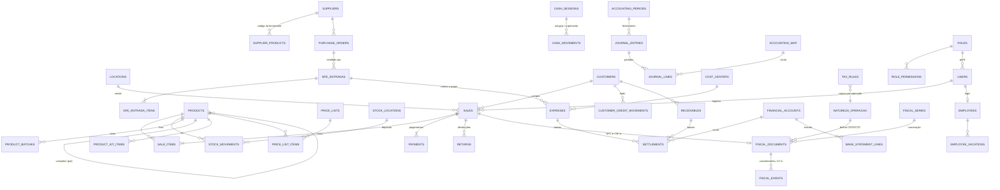

# GerenciaAI ERP: modelo de dados (Etapa 1)

Estado: 01/11/2026. Para aprovação antes da Etapa 2.
Documentos irmãos: `ERP-FISCAL-RULES.md` (regras fiscais), `ERP-GAP.md` (o que existe × o que falta e o plano).

## Convenções (decididas: manter as do GerenciaAI)

| Tema | Regra | Por quê |
|---|---|---|
| Banco | SQLite local (better-sqlite3), um arquivo por instalação | funciona offline; já em produção |
| Empresa | **uma instalação = um CNPJ**; filiais = instalações no mesmo grupo multi-PDV | isola dados por banco; nenhum parâmetro do renderer alcança outra empresa |
| Ids | `TEXT` UUID gerado no app | sync entre máquinas sem colisão |
| Dinheiro | `REAL` em reais, arredondado a 2 casas no resultado; custo unitário com 4 casas | padrão de todo o banco; migrar para centavos foi descartado (risco nos dados das lojas) |
| Data de calendário | `TEXT` `AAAA-MM-DD` local (`timeService.hojeLocalISO()`) | evita o bug de fuso (UTC−3) |
| Instante de evento | `TEXT` UTC (`NOW_SYNCED()`), comparado com `'-3 hours'` | igual ao resto do app |
| Estoque | livro imutável (`stock_movements`); correção = lançamento novo | regra já existente |
| Financeiro/fiscal | documento emitido e baixa nunca são apagados; estorno/cancelamento = registro novo | auditoria |
| Migração | tabela nova: `CREATE TABLE IF NOT EXISTS` no `schema.sql`; coluna nova em tabela antiga: `migrateColumnsIfNeeded` + índice logo depois | regra do `CLAUDE.md` (já derrubou produção) |
| Migração versionada (novo) | tabela `schema_migrations(versao, aplicada_em, descricao)`; cada migração nova tem `up` e `down` testados em base populada | pedido do prompt; as antigas continuam aditivas |
| Auditoria | `audit_log` + colunas novas `dados_antes`/`dados_depois` (JSON) | pedido: antes/depois em toda alteração |
| Regra fiscal | tabelas com vigência e fonte (`tax_rules`, `natureza_operacao`, tabelas de referência), nunca alíquota no código | legislação muda |
| Linguagem | código JavaScript; camada fiscal nova pode usar JSDoc com tipos (sem TypeScript no build) | decisão de manter a stack |

## Diagrama de entidades (núcleo)

Entidades em MAIÚSCULAS que ainda não existem no banco estão marcadas ⬜ nas tabelas abaixo.

## Entidades por módulo

Legenda: ✅ existe · 🟡 existe, precisa de colunas/ajuste · ⬜ nova (proposta)

### Núcleo e cadastros
| Tabela | | Conteúdo / mudança proposta |
|---|---|---|
| `fiscal_config` | 🟡 | dados da empresa (CNPJ, IE, razão, regime, UF, IBGE, endereço, certificado, CSC, série NFC-e). **+** `inscricao_municipal`, `cnae_principal`, `crt` explícito |
| `locations` | ✅ | loja/PDV desta instalação |
| `users` | 🟡 | papel fixo (`role`). **+** `role_id` para perfis customizáveis |
| `roles` / `role_permissions` | ⬜ | perfis customizáveis com permissão por **ação** (desconto até X%, cancelar, estornar, ver custo, exportar, alterar preço, caixa, financeiro, configurações). Os 5 papéis atuais viram perfis-semente; `user_permission_overrides` continua para exceções |
| `customers` | 🟡 | ✅ `limite_fiado`, `fiado_bloqueado` (migração 1). **+** `tipo_pessoa`, `ie`, `indicador_ie`, `cep`, `endereco_json`, `email`, `prazo_fiado_dias` |
| `suppliers` | 🟡 | **+** `ie`, `cep`, `endereco_json`, `contato` |
| `carriers` | ⬜ | transportadoras (CNPJ, IE, placa/UF, RNTRC) para NF-e |
| `products` | 🟡 | já tem EAN, SKU, NCM, CEST, CFOP, CSOSN/CST, origem, unidade, fornecedor, foto. **+** `produto_pai_id` + `variacao_json` (tamanho/cor; cada variação é um produto com EAN e estoque próprios, então PDV/estoque/fiscal não mudam), `codigo_lc116`, `cnae_servico`, `aliquota_iss` (serviços), `controla_serie` |
| `product_kit_items` | ⬜ | kit/composição: componente + quantidade; venda do kit baixa os componentes |
| `price_lists` / `price_list_items` | ⬜ | varejo/atacado: preço por lista e quantidade mínima; cliente pode ter lista padrão |
| `categories`, `product_batches`, `product_cost_history`, `product_price_history` | ✅ | categorias, lote/validade, custo médio, histórico de preço |
| `product_serials` | ⬜ | número de série por unidade (entrada → venda) |
| `cost_centers`, `accounting_map` | ✅ | centros de custo e de-para do plano de contas |
| `commission_rules`, `sales_goals` | ✅ | comissão e metas |

### Vendas, PDV e caixa
| Tabela | | Conteúdo / mudança proposta |
|---|---|---|
| `sales`, `sale_items`, `payments` | 🟡 | venda, itens (com custo no momento), pagamentos múltiplos. **+** `payments.parcelas` (crédito parcelado → recebíveis por parcela), `sales.natureza_operacao_id`, `sales.price_list_id` |
| `quotes`, `quote_items` | ✅ | orçamento → venda |
| `returns`, `return_items` | ✅ | devolução com autorização de gerente |
| `cash_sessions` | ✅ | abertura/fechamento + `conferencia_json` (conferência por forma de pagamento) |
| `cash_movements` | ✅ | sangria e suprimento (tipo, valor, motivo, operador); só inclusão (gatilho) |
| `mobile_sales`, `pdv_terminal_*`, `group_sync_sales` | ✅ | idempotência do celular e sync entre PDVs |

### Compras e estoque
| Tabela | | Conteúdo / mudança proposta |
|---|---|---|
| `purchase_orders`, `purchase_order_items` | ✅ | pedido de compra |
| `purchase_quotes` / `purchase_quote_items` | ⬜ | cotação entre fornecedores (preço/prazo por fornecedor, escolhe vencedor → vira pedido) |
| `nfe_entradas`, `nfe_entrada_itens`, `nfe_entrada_duplicatas`, `supplier_products` | ✅ | XML de entrada, conferência, código do fornecedor memorizado |
| `stock_movements` | 🟡 | livro. **+** `stock_location_id` (nulo = depósito principal) e tipos `transferencia`, `bonificacao` |
| `stock_locations` | ⬜ | depósitos dentro da loja (loja, depósito, avariados) |
| `inventory_counts`, `inventory_count_items` | ✅ | inventário com acerto |

### Financeiro
| Tabela | | Conteúdo / mudança proposta |
|---|---|---|
| `expenses` (pagar), `receivables` (receber), `customer_credit_movements` (fiado) | ✅ | `juros`, `multa`, `desconto`, `parcial_de_id` (+ `expenses.valor_original`). Baixa parcial: o saldo vira um título novo ligado por `parcial_de_id` (sem tabela `settlements`: os relatórios existentes continuam certos). ⬜ `conta_id`, fim da exclusão física |
| `settlements` | ✖ | substituído pelo desdobramento do título (ver linha acima) |
| `financial_accounts` / `financial_transfers` | ⬜ | contas (caixa, banco, cartão) e transferências entre elas; saldo por conta |
| `expense_recurrences`, `card_fee_config`, `bank_statement_lines` | ✅ | recorrentes, taxas de cartão, extrato OFX (CSV: novo parser) |
| `payment_gateways` / `boletos` | ⬜ | integração de boleto/PIX/CNAB (Etapa 6) |

### Fiscal
| Tabela | | Conteúdo / mudança proposta |
|---|---|---|
| `nfce_emitidas`, `nfce_inutilizacoes` | 🟡 | NFC-e atual. Passa a ser visão de `fiscal_documents` (modelo 65) sem quebrar a tela de hoje |
| `fiscal_documents` | ⬜ | **todo documento emitido**: modelo (55/65/NFS-e), série, número, chave, natureza, destinatário, totais, status, protocolo, xml_path, ambiente, `idempotency_key` (UNIQUE), tentativas |
| `fiscal_document_items` | ⬜ | itens com o resultado do motor (CFOP, CST, bases, alíquotas, valores por tributo, cClassTrib) — o que foi para o XML fica gravado |
| `fiscal_events` | ⬜ | cancelamento, CC-e (sequência), inutilização, manifestação; protocolo e XML de cada evento |
| `fiscal_series` | ⬜ | série e próximo número por modelo/ambiente, reservado em transação (sem buraco; buraco vira inutilização) |
| `fiscal_transmission_log` | ⬜ | cada chamada à SEFAZ: requisição, resposta, código, tempo — sem dado de certificado |
| `nfe_destinadas` | ⬜ | NF-e de terceiros baixadas (DF-e) e a manifestação do destinatário |
| `natureza_operacao` | ✅ | semeada na migração 1: tipo, finalidade, CFOP dentro/fora do estado, com e sem ST, fonte |
| `tax_rules` | ✅ | motor tributário versionado (+ `natureza_operacao_id`) |
| `ref_ncm`, `ref_cest`, `ref_cfop`, `ref_aliquotas_uf` | ⬜ | tabelas de referência importáveis (com vigência e fonte) para validação em tempo real |
| `tax_assessments` | ⬜ | apuração mensal (ICMS, PIS, COFINS, DAS) com memória de cálculo e guia gerada |

### Contabilidade
| Tabela | | Conteúdo / mudança proposta |
|---|---|---|
| `accounting_map` | 🟡 | de-para atual → vira `chart_of_accounts` com código referencial ECD, natureza e nível |
| `journal_entries` | ✅ | lançamentos **manuais** gravados (débito, crédito, valor, histórico, `estorno_de_id`), só inclusão; os automáticos continuam calculados das origens e congelados no fechamento |
| `accounting_periods` | ✅ | mês fechado com a foto (`snapshot_json`); despesa, baixa, recebimento e lançamento com data no mês recusam |

### Pessoas
| Tabela | | Conteúdo / mudança proposta |
|---|---|---|
| `employees`, `employee_vacations` | ✅ | cadastro, documentos, férias |
| `payroll_*` | ⬜ (fase 2) | pró-labore, INSS, IRRF, FGTS com tabelas parametrizadas e vigência |

### Sistema
| Tabela | | |
|---|---|---|
| `audit_log` | ✅ | `entidade`, `entidade_id`, `dados_antes`, `dados_depois` (migração 1); UPDATE/DELETE recusados por gatilho |
| `schema_migrations` | ✅ | migrações versionadas com `up`/`down` (`electron/db/migracoes.js`) |
| `consents` | ⬜ | LGPD: aceite de termo/política e consentimento de envio à IA (versão, data, usuário) |
| `backup_config`, `modulos_pagos_state`, `license_state` | ✅ | backup, módulos ativáveis por empresa, licença |

## Regras de integridade que valem para todas as tabelas novas
1. Dinheiro sai sempre de uma função de arredondamento (`arred`) antes de gravar.
2. Documento/baixa/lançamento nunca é apagado: status `cancelado`/`estornado` + registro do estorno.
3. Operações que mexem em mais de uma tabela rodam numa transação só.
4. Toda chamada externa (SEFAZ, gateway) grava antes uma chave de idempotência; repetir não duplica.
5. Período contábil fechado bloqueia qualquer gravação com data dentro dele.
